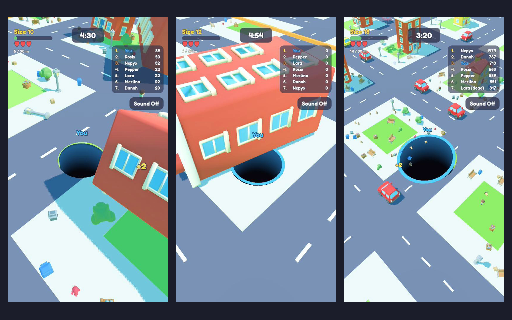

# Hungry Hole



A bright, toy-city "eat everything" arena game for Godot 4. You and six bots are holes in the ground. Anything that fits through your opening falls in and makes you bigger. Things that don't fit tip over when you clip their corner. Smaller holes are food too.

It's a fan remake inspired by Hole.io, built from scratch. All art, models, sounds and code are original to this project. It is not affiliated with or endorsed by the makers of Hole.io.

## How to play

- Drag with the mouse or a finger, or use WASD, the arrow keys or a gamepad stick. Space or a click starts the match. Esc pauses.
- Swallow anything that physically fits through your hole. Bigger things are worth more.
- Buildings too big to fit fall over toward the edge you clipped, and they knock over whatever they land on.
- Swallow smaller holes. Every hole has 3 lives and respawns after 3 seconds at the size it died, with 4 seconds of spawn protection.
- The first hole to reach 90 m wins. Otherwise the most points after 5 minutes wins, or the last hole with lives left.
- The city is built in three rings. Once 30% of what's there has been eaten, the next ring spawns in and the walls move out.
- Past level 30 a hole keeps growing slowly, so a champion can eventually eat everything.
- Sound can be turned on and off with the button under the leaderboard or in the pause menu.

## Run it

You need [Godot 4.7](https://godotengine.org/download). The standard build is enough: the project is pure GDScript. Open the folder in the editor and press Play, or run it from a terminal:

```bash
godot --path .
```

Debug flags go after `--`:

| Flag | What it does |
|---|---|
| `--autoplay` | A Hard bot drives your hole |
| `--god` | Your hole can't be eaten (for watching a full match) |
| `--mute` | No sound for this run, without changing the saved setting |
| `--quit-after=N` | Quit after N seconds and print the ranking and median FPS |
| `--screenshot=/abs/path.png --screenshot-at=N` | Save a screenshot at N seconds |
| `--trace` | Print every hole's level, XP and lives every 5 seconds |
| `--diag-eat` | Report objects that should have fallen in but didn't |
| `--topple-test`, `--edge-test`, `--kill-test`, `--overlap-test`, `--unlock-test` | Scripted physics and rules scenarios |

## Tests

```bash
godot --headless --path . --script res://tests/run_tests.gd
```

The tests cover the balance and XP tables, the movement model, camera curves, bot profiles, hole-versus-hole kills, lives, respawns, the win size and the ranking.

## How it's built

- **Holes** carry a ring-shaped collider around the opening, so things on the edge rest on the lip or tip in. Each hole runs a shape query every physics tick to find what is over its opening.
- **Falling** switches an object's collision from the ground to the hole's own rim layer, so it really drops through the opening. It counts as eaten once it is deep enough below the ground.
- **Toppling** keeps a too-big building on the real ground and applies a torque toward the clipped corner until its centre of mass passes the pivot edge. Gravity does the rest.
- **The city** is generated on a grid of 5 m tiles: roads, blocks, parks and plazas, filled with 17 low-poly models. Ground tiles are MultiMesh instances, and the ground shader cuts an opening under each hole.
- **Performance**: idle objects are frozen and skip per-tick processing until a hole reaches them. Physics runs on Jolt at 60 Hz with interpolation.
- **Bots** pick targets by value and distance, hunt smaller holes only when they're clearly bigger, and get more aggressive as the match goes on.
- **Tuning** lives in Resource scripts under `resources/`: sizes, speeds, XP per level, bot profiles and match rules.

## Assets

- The 3D models were generated with Tripo from four-view reference sheets (front, back, left, right) drawn for this project's Crossy Road-style palette.
- The font is [Fredoka](https://fonts.google.com/specimen/Fredoka), under the SIL Open Font License (`assets/fonts/OFL.txt`).
- Sound effects are simple tones generated in code (`autoload/audio_manager.gd`). Drop OGG files into `assets/final/sfx/<tag>.ogg` to replace them.
